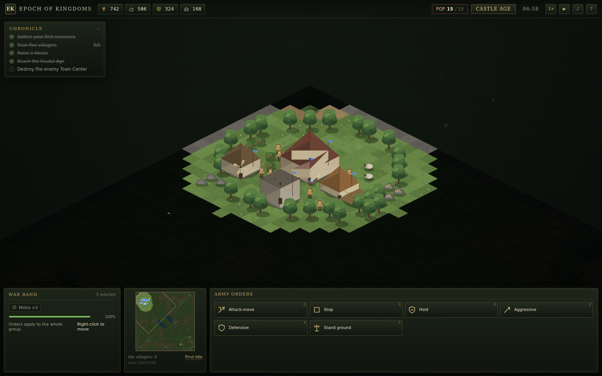

# Epoch of Kingdoms

A single-player browser RTS in the lineage of *Age of Empires II*. One seeded map, two kingdoms, three ages, and a conquest victory. Everything — terrain, units, buildings, effects, and sound — is generated in the page. No game engine, no runtime dependencies, no installs.

[**Play Epoch of Kingdoms**](https://gerrcass.github.io/epoch-of-kingdoms/)



## What is in the build

- **A deterministic 30 Hz simulation.** The world is driven by a seeded PRNG and a command queue. The same seed plus the same commands produce the same hash.
- **Four resources and three ages.** Villagers gather food, wood, gold, and stone; houses raise population; the Town Center advances from the Dark Age through Feudal to Castle.
- **A real opponent.** The AI scouts, expands its economy, builds production, researches, and sends waves. Three difficulties change its pace and army size.
- **Fog of war and a minimap.** Explored ground stays dimmed; hidden enemies do not render. The minimap doubles as a camera.
- **A context-sensitive command card.** Train, research, advance, build, repair, set rally points, attack-move, hold, and choose stances. Every button has a hotkey.
- **Original procedural presentation.** Isometric chunked terrain, painter's-order sprites, particles, screen shake, and a WebAudio soundscape synthesized at runtime.

## Controls

| Input | Action |
| --- | --- |
| Left click / drag | Select a unit or building; drag for a box selection |
| Shift + click | Add to or remove from the selection |
| Double-click | Select all units of that type on screen |
| Right click | Context order: move, gather, attack, repair, or set a rally point |
| Arrow keys / screen edge | Pan the camera |
| Mouse wheel | Zoom |
| `Space` | Centre on the Town Center |
| `.` | Cycle idle villagers |
| `Q` `E` `R` `T` … | Command-card hotkeys (shown in the card) |
| `P` | Pause |
| `F1` | Controls |
| `Esc` | Cancel placement / close a panel |
| `Ctrl`/`Alt` + `1–9` | Store a control group |
| `1–9` | Recall a control group |

The same hotkeys are listed in the in-game controls panel.

## Development

```bash
npm install
npm run dev        # Vite dev server
npm run check      # typecheck + lint + unit tests
npm run test:e2e   # Playwright browser suite, including the README capture
npm run build      # production build in dist/
```

The simulation is headless and tested at the seam in `tests/`. The renderer reads the world and never writes it. `src/main.ts` owns the fixed-step loop, input wiring, audio, and menu flow.

### Layout

```text
src/sim/       deterministic world, map generation, pathfinding, content tables, AI
src/render/    isometric projection, terrain chunks, procedural art, fog, minimap
src/ui/        DOM HUD, command card, selection, input mapping
src/audio/     procedural WebAudio effects
tests/         Vitest simulation suite
e2e/           Playwright browser suite and screenshot capture
docs/          spec, ADRs, design notes, media
```

### Determinism

The simulation never reads the wall clock, the DOM, or `Math.random`. A match is `seed + ordered commands`. The HUD exposes a small `window.__epoch` debug surface used by the Playwright suite to start a match, inspect state, and fast-forward ticks.

The soundtrack is synthesized on first interaction, so browsers never autoplay audio.

## Deployment

Pushes to `main` run the merge gate and deploy `dist/` to GitHub Pages through `.github/workflows/pages.yml`. The Vite base is relative, so the same bundle works at a project subpath.

## Credits

Design, code, and art are original to this repository. Built with Vite, strict TypeScript, Canvas 2D, and the DOM. No runtime dependencies. The visual language is inspired by the isometric RTS tradition, not extracted from any existing game.
